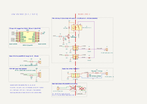
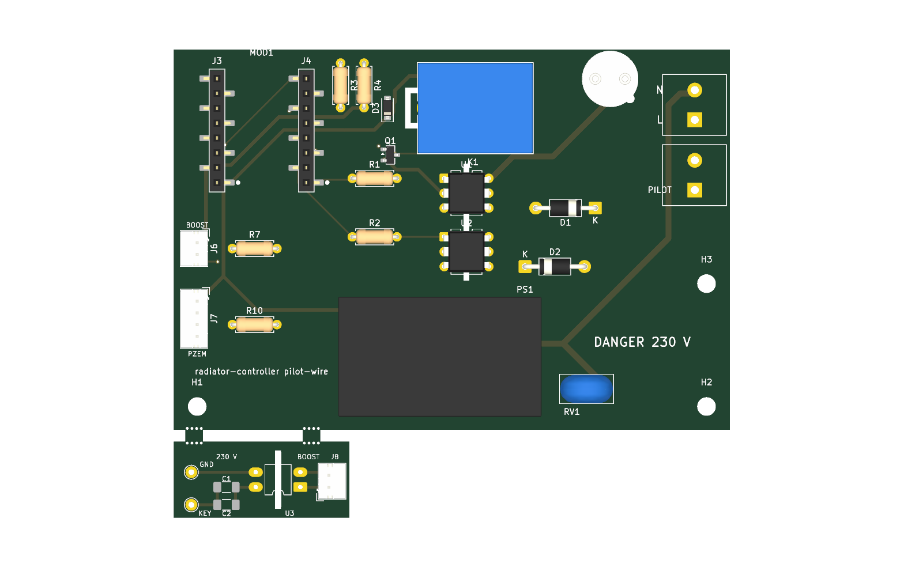
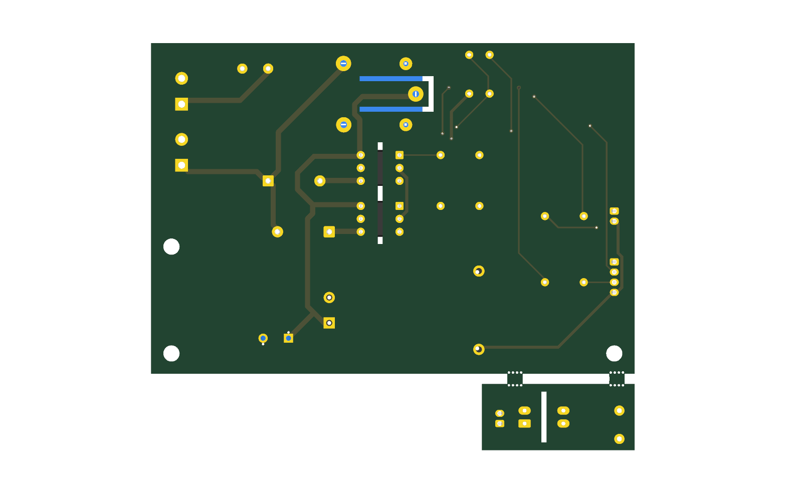
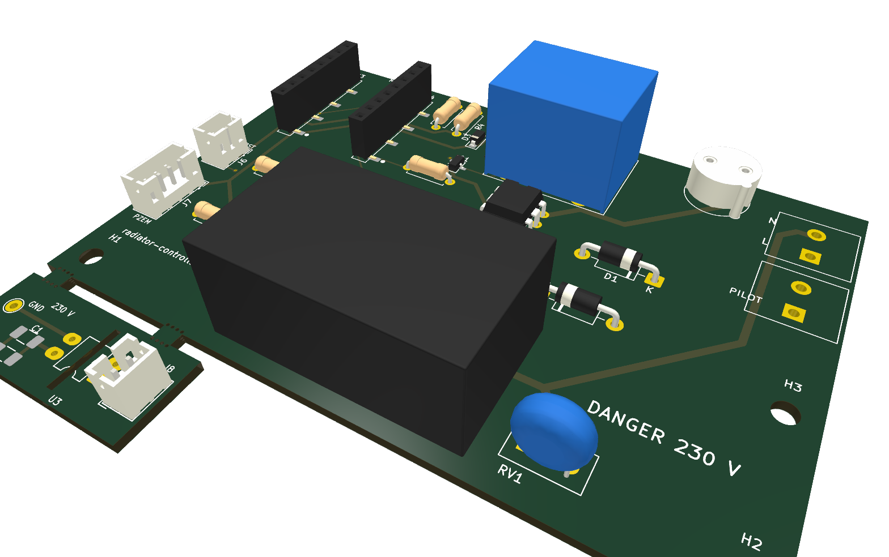
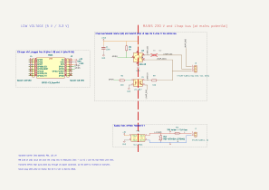
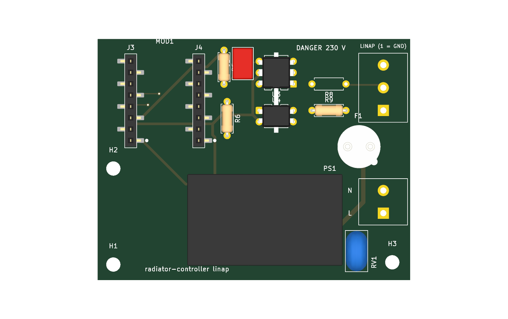
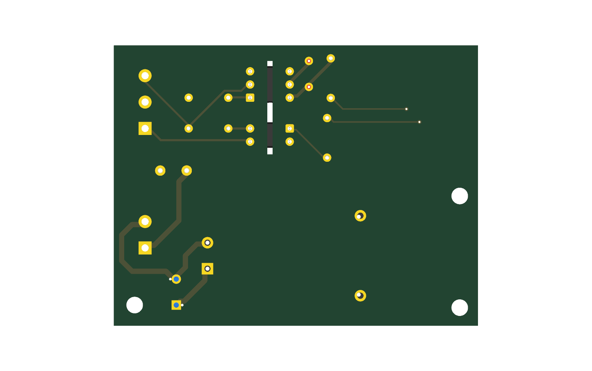
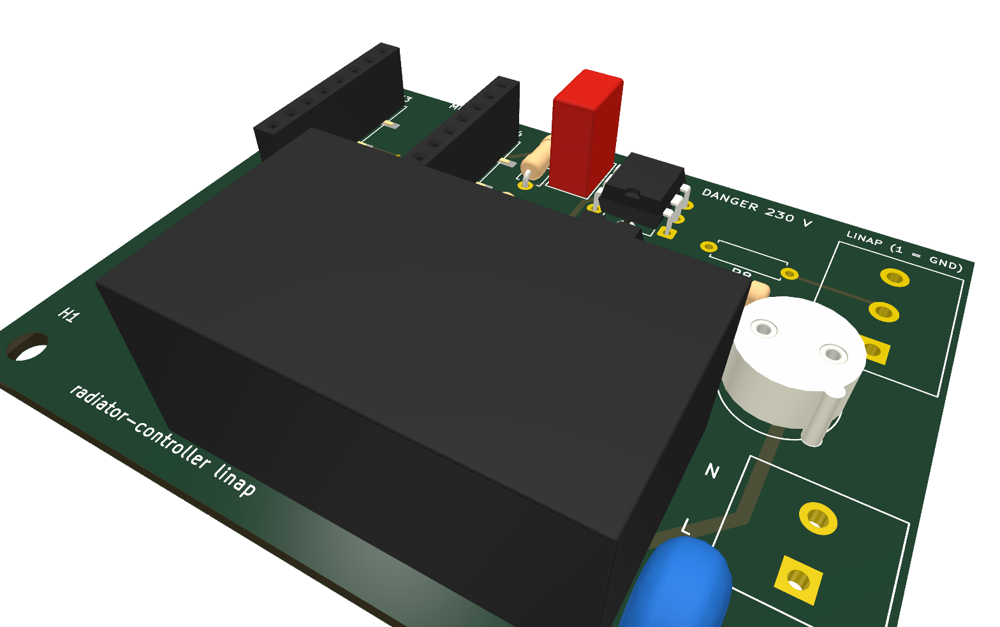

# sauter-marapi-esphome

[Français](README.md) · **English**

DIY module that drives the **Sauter Marapi tactile 1750 W** electric towel radiator (fan-assisted bathroom heater, anthracite) from Home Assistant, through its French **6-order pilot wire** (*fil pilote*: Comfort, Comfort −1, Comfort −2, Eco, Frost protection, Off).

ESPHome firmware on an ESP32-C3 super mini, two MOC3043 optotriacs + diodes, a fail-safe relay that falls back to Eco, powered from the radiator's own 230 V wall supply. This is the initial board; a final board will go through the radiator's internal bus (Linap) once its protocol is analysed.

> [!WARNING]
> **Study phase.** The add-on module (schematic, PCB, firmware) has not been built or tested yet: everything about it is **theoretical**. Only the manufacturer data (manual, pilot wire signals) and the photos of the original control board are facts; the reverse engineering leads (Boost key, internal link) are hypotheses. Check everything before building it.

**Keywords**: Sauter Marapi tactile, electric towel radiator, towel warmer, bathroom fan heater, fil pilote, pilot wire, Groupe Atlantic, ESPHome, Home Assistant, home automation, ESP32-C3, MOC3043, control board `HM011 TD1N01 RAD`, `74 60 5004`, STM32F091CCT6, capacitive touch keys, Boost button, Linap link, Err 10.

## Repository layout

| Folder | Content |
|---|---|
| `firmware/` | ESPHome configuration: `common.yaml` (Wi-Fi, API, OTA, LED, diagnostics), `controlleur-seche-serviettes.yaml` (pilot wire), `secrets.example.yaml` |
| `hardware/` | KiCad 10, two boards (see *Two boards*): `pilot-wire/` (initial board) and `linap/` (final board), each with a schematic (`.kicad_sch`, `.svg` render), a PCB (`.kicad_pcb`, `-top.png` / `-bottom.png` / `-3d.png` renders) and a `.step` 3D model for the enclosure; `lib/`, shared by both: C3 super mini symbol, footprints (`radiator-controller.pretty/`, generated by `footprints.py`), isolation rules (`isolation.kicad_dru`); `export-fabrication.sh` (fabrication files and LCSC cart) |
| `enclosure/` | enclosure (to come) |
| `discovery/` | Linap bus reverse engineering, stage by stage (listen, fake power board, fake command board): ESPHome firmware of each stage, KiCad schematic of the bench (`linap-bench.kicad_sch`), decoder, procedure and bench revisions (`README.md`, in French) |
| `knowledge/` | design notes, in French: `architecture.md` (roles, contract, safety), `fil-pilote.md` (signals, initial board), `linap.md` (Linap bus, final board), `backlog.md` (including control board reverse engineering), Sauter manual (`manuals/`) |

## ⚠️ Mains voltage

The module works on 230 V mains, in a bathroom. Read the *Sécurité* section of `knowledge/fil-pilote.md` before wiring anything. Switch off the breaker before any work.

## Pilot wire

The order is the voltage between the pilot wire and neutral:

| Order | Signal |
|---|---|
| Comfort | nothing (0 V) |
| Eco | full 230 V sine wave |
| Frost protection | negative half-wave only |
| Off / load shedding | positive half-wave only |
| Comfort −1 / −2 | 230 V for 3 s / 7 s every 300 s |

On the radiator, select the **Programme Inactif** mode so that it obeys the pilot wire. The Boost (fan) cannot be triggered by the pilot wire: see `knowledge/backlog.md`.

## Two boards

Two boards, developed side by side, on the same C3 and the same power supply.

| Board | Folder | Role | Size |
|---|---|---|---|
| **initial** | `hardware/pilot-wire/` | drives the towel rail through the **pilot wire** and triggers the **Boost** by simulating a touch on its key; optional PZEM-004T power meter | 95 × 65 mm, plus the 30 × 13 mm break-off Boost board (95 × 80 mm overall) |
| **final** | `hardware/linap/` | reads and writes the radiator's internal **Linap bus**, isolated; replaces the pilot wire and the simulated key once the protocol is known | 70 × 54 mm |

The final board is also the analysis tool: it captures the Linap frames through its optocoupler, with no logic analyser on the mains side.

### Initial board: pilot wire and Boost



[KiCanvas](https://kicanvas.org/?github=https://github.com/Plokkke/sauter-marapi-esphome/blob/main/hardware/pilot-wire/radiator-controller-pilot-wire.kicad_sch) · details in `knowledge/fil-pilote.md` (in French).

| C3 super mini | Connected to |
|---|---|
| `5V` / `GND` | HLK-PM01 output |
| `GPIO5` | 220 Ω → MOC3043 U1 (positive half-wave) |
| `GPIO6` | 220 Ω → MOC3043 U2 (negative half-wave) |
| `GPIO7` | 1 kΩ → MMBT2222A → relay K1 (normally closed contact = Eco); 10 kΩ pull-down on the base |
| `GPIO10` | 220 Ω → J6, then a JST PH 2 cable to J8: LED of photoMOS U3 on the Boost board |
| `GPIO20` / `GPIO21` | J7, PZEM-004T power meter UART (optional) |

| Top | Bottom | 3D |
|---|---|---|
|  |  |  |

- **Isolation**: relay K1, optotriacs U1 and U2 and the HLK-PM01 straddle the boundary between low voltage (left) and 230 V (right); a 1 mm slot runs under U1 and U2.
- **SRD relay**: its common pin (230 V) sits between the two coil pins (5 V). A U-shaped slot surrounds it, open only towards the 230 V side, which brings the creepage distance above 6 mm.
- **Boost board**: below the main board, held by two mouse-bite bridges, it is snapped off by hand before assembly and fits inside the control box, next to the Boost key. It carries J8, photoMOS U3 (DIP-4), two capacitor footprints in parallel (C1, C2) and two solder pads (TP1 key electrode, TP2 control board ground). The radiator side is at mains potential: a 1 mm slot under U3 brings the creepage above 6 mm. U3, C1 and C2 are chosen at the bench and are not in the cart.

### Final board: Linap bus



[KiCanvas](https://kicanvas.org/?github=https://github.com/Plokkke/sauter-marapi-esphome/blob/main/hardware/linap/radiator-controller-linap.kicad_sch) · details in `knowledge/linap.md` (in French).

| C3 super mini | Connected to |
|---|---|
| `5V` / `GND` | HLK-PM01 output |
| `GPIO3` | Linap receive: output of optocoupler U3 (H11L1M), 1 kΩ pull-up |
| `GPIO4` | Linap transmit: 220 Ω → LED of optocoupler U4 (LTV-817), which pulls DATA low |

| Top | Bottom | 3D |
|---|---|---|
|  |  |  |

### Shared by both boards

- **C3 super mini**: plugged into two 1×8 SMD sockets (J3, J4) 15.24 mm apart, as on the boiler board, antenna against the top edge. The C3 is not soldered: on the board it is only an outline, with a copper keepout under the antenna. In the schematic, its symbol shows the pins in their physical place, top view, USB up.
- **Design rules** (`hardware/lib/isolation.kicad_dru`, linked from both projects): 3 mm clearance and 6 mm creepage between the mains side (230 V and Linap bus) and low voltage; 2.5 mm between 230 V conductors, and between them and the Linap bus. For each board, DRC (`kicad-cli pcb drc --schematic-parity`) finds no error, no missing connection and no mismatch with the schematic; silkscreen warnings remain (references cut by the slot or the edge).

### Ordering

`hardware/export-fabrication.sh pilot-wire` (or `linap`, KiCad 10) writes into `hardware/<board>/fabrication/`:

- `…-gerbers.zip`, the JLCPCB fabrication files. The initial board and its Boost board share one outline: check on the quote that JLCPCB does not charge it as a panel;
- `…-lcsc-cart.csv`, the LCSC cart for LCSC's *BOM Tool*. Disable the `in stock` lines (220 Ω and 1 kΩ resistors already in stock) and, when JLCPCB assembles the board, the `JLCPCB` lines;
- `…-bom-jlcpcb.csv` and `…-cpl.csv`, for the optional JLCPCB assembly of the SMD parts;
- `…-bom.csv`, the full bill of materials.

Every part carries its LCSC number in the schematic (`LCSC` field); `split-bom.py` builds the cart from it. Footprints are generated by `hardware/lib/footprints.py` from the part datasheets. Parts, numbers and roles: `knowledge/fil-pilote.md` and `knowledge/linap.md`, *Nomenclature* (in French).

## Firmware

The current firmware is the initial board's (pilot wire). The final board's waits for the Linap frame analysis.

```sh
uv tool install esphome
cp firmware/secrets.example.yaml firmware/secrets.yaml   # then fill in the values
cd firmware
esphome run controlleur-seche-serviettes.yaml --device /dev/cu.usbmodemXXXX   # first flash, off mains (hold BOOT while plugging if no port shows up)
esphome run controlleur-seche-serviettes.yaml --device controlleur-seche-serviettes.local   # then over the air
esphome logs controlleur-seche-serviettes.yaml --device controlleur-seche-serviettes.local
```

## Home Assistant entity

`select.controlleur_seche_serviettes_pilot_wire_order`: `Comfort`, `Comfort -1`, `Comfort -2`, `Eco`, `Frost protection`, `Off`. On failure, or after 30 min without Home Assistant: `Eco`.
