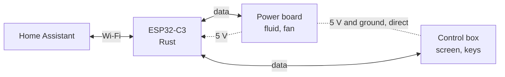

# sauter-marapi-esphome

[Français](README.md) · **English**

Control your Sauter Marapi towel radiator from Home Assistant while keeping its own screen and keys: a small Wi-Fi board sits on the radiator's internal bus.


> [!NOTE]
> **Project status.** The internal bus protocol is decoded, and both halves of the design are proven with an ESP on the bench: it drives the power board on the radiator, and it reads the control box on the bench. The Rust firmware of the board is written and builds, not yet tried on the radiator; the final board and its enclosure are still to be done.

## What it does

- **Monitor the radiator**: setpoint, Boost and off as set on the keys, heating in progress.
- **Control it from Home Assistant**: setpoint, Boost (fan), off.
- **Keep the original appliance**: the screen and keys keep working as before; the last one to speak, key or Home Assistant, wins.
- **Nothing to wire to 230 V**: the board runs from the ribbon's 5 V, like the control box.
- **Safe**: without Home Assistant the board just passes everything through, and the radiator works as it did originally. If the board itself fails, the radiator stops ("Err 10"): unplug it and reconnect the original ribbon.

## Compatibility

Studied on a **Sauter Marapi tactile 1750 W** (750 W fluid element and 1000 W fan), control box `HM011 TD1N01 RAD`. Towel radiators and heaters of the Atlantic group (Atlantic, Thermor, Sauter) that show "Err 10" when their internal ribbon is unplugged probably use the same bus: check with the sniffer in `discovery/`.

## How it works

The radiator has two boards, joined by a three-wire ribbon (ground, 5 V, data):

- the **control box** (screen, capacitive keys) chooses the setpoint, the mode and the Boost;
- the **power board** heats the fluid and runs the fan, based on its own temperature sensor. It leads the exchange: it **polls** the control box several times a second, and the control box answers with its state.

The board cuts the data wire and sits between the two (*man in the middle*). By default it **relays** every poll and every answer, and Home Assistant sees what happens. On Home Assistant's request it **answers instead of** the control box, until the next key press.



**Limitation**: the control box accepts no order over the bus. Its screen always shows what was set on its keys: a Boost started by Home Assistant does not show there.

## The internal bus in a nutshell

The frame-by-frame details are in [`knowledge/linap.md`](knowledge/linap.md) (in French).

- One data wire, **9600 baud, 7 data bits and odd parity**. Frames are **5 bytes**: a header, 3 data bytes, then their XOR.
- The power board sends `75`, `C7` and `61` in a loop (305 ms cycle). After `75` and `C7` it sends the lone byte `46`: the poll. The control box answers **within the next bit** with 3 bytes and the checksum:

| Answer to `46` | Meaning |
|---|---|
| `B0 cc 80` | on, setpoint = `cc` without its bit 7, divided by 2 |
| `38 80 80` | Boost |
| `80 80 80` | off |

- The power board reports its state in `C7`: `80 E0 38` idle, `01 E0 38` heating, `83 E0 98` Boost, `80 E0 40` off.
- **The power board obeys whoever answers its polls in time.** **The control box cannot be driven**: it only answers the `46` and `70` polls, and none of the 280 or so frames tried changed its setpoint or its screen.

## Decoding the protocol

There is no documentation of this bus. It was decoded with a **Wemos D1 mini** wired to the ribbon, in three stages. The firmwares, the bench schematic and the tools are in [`discovery/`](discovery/README.md) (in French).

| Stage | The ESP… | Result |
|---|---|---|
| 1. Listen | listens to the ribbon between both boards | frame format, setpoint, Boost, off |
| 2. Fake power board | polls the control box alone, on the bench, off mains | it answers with everything done on its keys, but accepts no order |
| 3. Fake control box | answers the power board, on the radiator | it follows the setpoint, the Boost and off |

> [!WARNING]
> **The internal bus is at mains potential.** During the tests on the radiator, the ESP floats at that potential: lab supply with a floating output, Wi-Fi only, never USB nor an earthed device. Switch off the breaker before touching the setup. If in doubt, call an electrician.

## Hardware

> [!NOTE]
> Work in progress: the board is still to be drawn, with two channels and a receiver fast enough to answer within the bit that follows the poll ([backlog](knowledge/backlog.md), in French).

What will not change:

- **An ESP32-C3 with an external antenna**, firmware in Rust: two full UARTs, one per channel, and interrupt-driven answers to the polls. Space is not an issue inside the radiator, and a good antenna matters, far from the router.
- **Powered by the ribbon**: the power board's 5 V holds about 160 mA in total, and a D1 mini plus the control box draw about 120 (VCC at 5.11 V, radiator power-ups and Boost validated); the C3 is still to be measured. No more 230 V wiring. A 470 to 1000 µF capacitor next to the ESP absorbs the Wi-Fi peaks.
- **On each channel**, the bench circuit: a voltage divider to read DATA, an NPN transistor to pull it low.
- **The whole board is at mains potential**, like the control box: it must be fully enclosed, with nothing touchable, and updated over Wi-Fi only.

## Firmware

The board's firmware is in **Rust** for the ESP32-C3, in [`firmware/`](firmware/README.md) (in French): frame logic tested on a computer (`linap/`), interrupt-driven answers to the polls and MQTT link to Home Assistant (`mitm/`).

```sh
cp firmware/secrets.example.env firmware/secrets.env   # Wi-Fi and MQTT account
(cd firmware/linap && cargo test)
(cd firmware/mitm && cargo run --release)             # USB flash, before any wiring
```

The bench firmwares are ESPHome configurations for a D1 mini, in `discovery/`:

```sh
uv tool install esphome
cp discovery/esphome/secrets.example.yaml discovery/esphome/secrets.yaml   # Wi-Fi, API key, OTA password
esphome run discovery/1-sniffer/linap-sniffer.yaml       # first flash over USB, before any wiring
esphome logs discovery/1-sniffer/linap-sniffer.yaml | discovery/tools/decode.py
```

## In Home Assistant

Through MQTT discovery (details: [`firmware/README.md`](firmware/README.md)):

| Entity | Use |
|---|---|
| Keys mode, Keys setpoint | what is set on the keys |
| Power board, Heating | what the power board does: idle, heating, Boost, off |
| Control | `relay` (the keys, default), `setpoint`, `boost`, `off` (imposed) |
| Setpoint | the setpoint in force; setting it from Home Assistant imposes it |

The last order wins: an order from Home Assistant replaces the keys' one, and the next change made on the keys takes over again.

The control box only sends its effective setpoint: in Eco, Home Assistant sees the Eco setpoint, without knowing it is Eco.

## Known limitations

- **Screen not synchronised**: what Home Assistant imposes does not show on the screen.
- **No temperature** yet: the power board has its sensor, but which frame carries the reading is not known yet.
- **Warranty**: opening the control box voids the warranty (2 years).

## Going further

- [`knowledge/linap.md`](knowledge/linap.md): the internal bus, frame by frame.
- [`knowledge/architecture.md`](knowledge/architecture.md): the board's role, chosen design, rejected options, safety.
- [`knowledge/backlog.md`](knowledge/backlog.md): what is left to do.
- `knowledge/manuals/`: Sauter manual.

All of `knowledge/` is in French.

---

**Keywords**: Sauter Marapi tactile, electric towel radiator, towel warmer, bathroom fan heater, Groupe Atlantic, Thermor, Atlantic, internal bus, Linap link, Err 10, man in the middle, reverse engineering, Rust, esp-hal, embassy, ESP32-C3, ESPHome, Home Assistant, home automation, ESP8266, Wemos D1 mini, control board `HM011 TD1N01 RAD`, `74 60 5004`, STM32F091CCT6, KiCad PCB.
