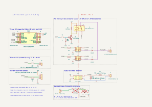
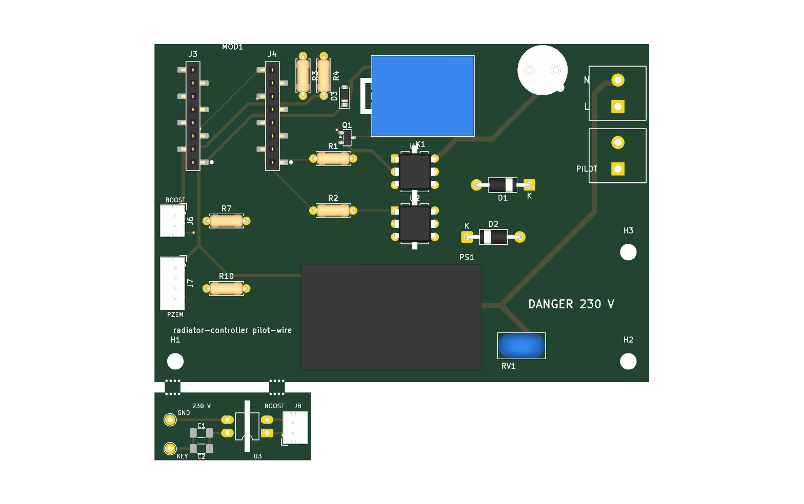
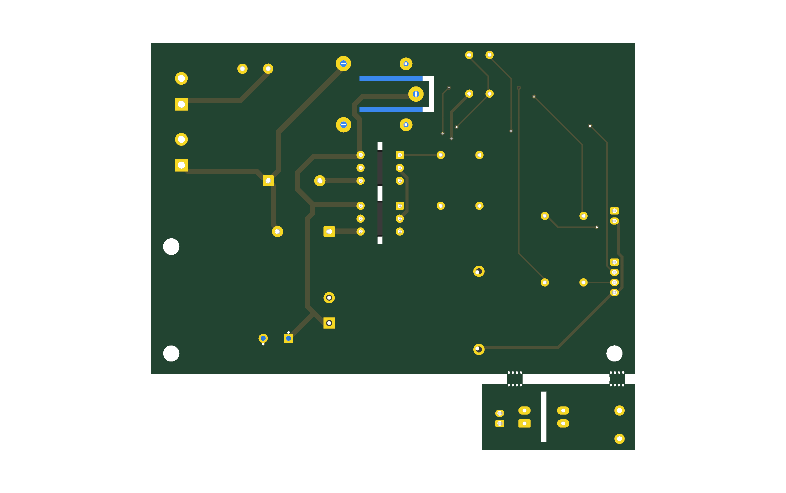
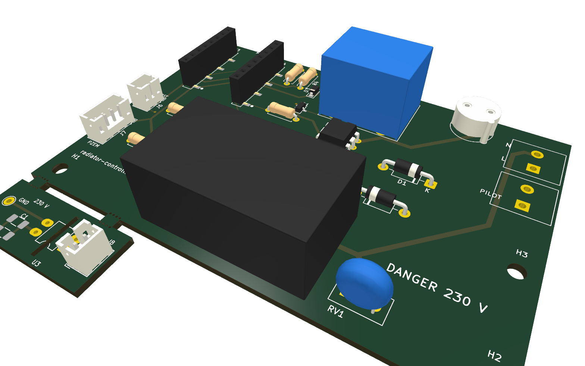
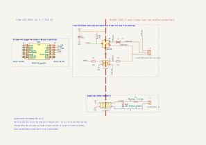
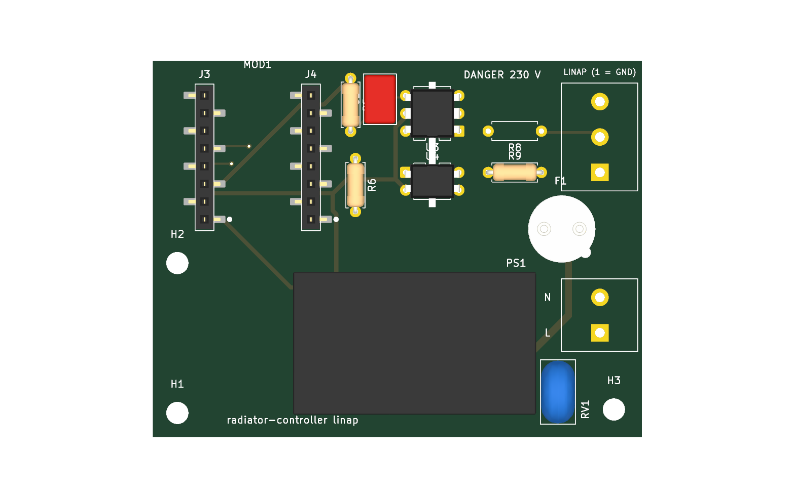
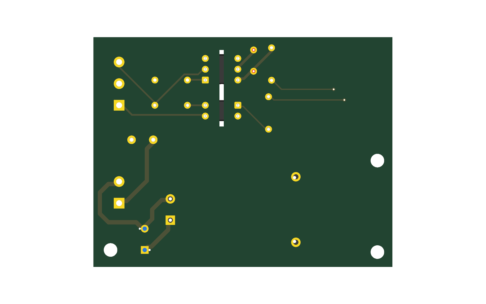
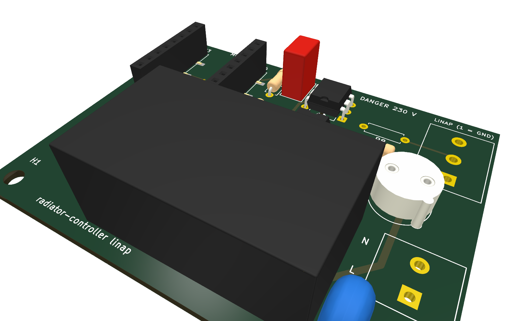

# sauter-marapi-esphome

**Français** · [English](README.en.md)

Module DIY qui pilote le sèche-serviettes **Sauter Marapi tactile 1750 W** (anthracite) depuis Home Assistant, par son **fil pilote 6 ordres** (Confort, Confort −1, Confort −2, Éco, Hors-gel, Arrêt).

Firmware ESPHome sur un ESP32-C3 super mini, deux optotriacs MOC3043 + diodes, un relais de repli en Éco, alimenté en 230 V par l'arrivée murale du sèche-serviettes. C'est la carte initiale ; une carte finale passera par le bus interne du radiateur (Linap), une fois son protocole analysé.

> [!WARNING]
> **Projet en phase d'étude.** Le module complémentaire (schéma, circuit imprimé, firmware) n'a encore été ni fabriqué ni testé : ses informations sont **théoriques**. Seules les données du fabricant (notice, signaux du fil pilote) et les photos de la carte d'origine sont des faits ; les pistes de rétro-ingénierie (touche Boost, liaison interne) sont des hypothèses. À vérifier avant toute réalisation.

**Mots-clés** : Sauter Marapi tactile, sèche-serviettes soufflant, radiateur fil pilote, Groupe Atlantic, ESPHome, Home Assistant, domotique, ESP32-C3, MOC3043, carte `HM011 TD1N01 RAD`, `74 60 5004`, STM32F091CCT6, touche Boost, liaison Linap, Err 10.

## Arborescence

| Dossier | Contenu |
|---|---|
| `firmware/` | configuration ESPHome : `common.yaml` (Wi-Fi, API, OTA, LED, diagnostic), `controlleur-seche-serviettes.yaml` (fil pilote), `secrets.example.yaml` |
| `hardware/` | KiCad 10, deux cartes (voir *Deux cartes*) : `pilot-wire/` (carte initiale) et `linap/` (carte finale), chacune avec schéma (`.kicad_sch`, rendu `.svg`), circuit imprimé (`.kicad_pcb`, rendus `-top.png` / `-bottom.png` / `-3d.png`) et modèle 3D `.step` pour le boîtier ; `lib/`, commun aux deux : symbole du C3 super mini, empreintes (`radiator-controller.pretty/`, produites par `footprints.py`), règles d'isolement (`isolation.kicad_dru`) ; `export-fabrication.sh` (fabrication et panier LCSC) |
| `enclosure/` | boîtier (à venir) |
| `discovery/` | rétro-ingénierie du bus Linap, étape par étape (écoute, fausse carte de puissance, fausse carte de commande) : firmware ESPHome de chaque étape, schéma KiCad du banc (`linap-bench.kicad_sch`), décodeur, procédure et évolution du montage (`README.md`) |
| `knowledge/` | `architecture.md` (rôles, contrat, sécurité), `fil-pilote.md` (signaux, carte initiale), `linap.md` (bus Linap, carte finale), `backlog.md`, notice Sauter (`manuals/`) |

## ⚠️ 230 V

Le module travaille sur le secteur, dans une salle de bains. Lire la section *Sécurité* de `knowledge/fil-pilote.md` (et de `knowledge/linap.md` pour la carte finale) avant de câbler. Couper au tableau avant toute intervention.

## Deux cartes

**DÉCIDÉ** : deux cartes, développées en parallèle, sur le même C3 et la même alimentation.

| Carte | Dossier | Rôle | Taille |
|---|---|---|---|
| **initiale** | `hardware/pilot-wire/` | pilote le sèche-serviettes par le **fil pilote** et déclenche le **Boost** en simulant un appui sur la touche ; compteur PZEM-004T en option | 95 × 65 mm, plus la carte Boost détachable de 30 × 13 mm (95 × 80 mm en tout) |
| **finale** | `hardware/linap/` | lit et écrit le **bus Linap** interne du radiateur, isolé ; remplace le fil pilote et la touche simulée une fois le protocole connu | 70 × 54 mm |

La carte finale sert aussi d'outil d'analyse : elle capture les trames Linap à travers son optocoupleur, sans analyseur logique côté secteur.

### Carte initiale : fil pilote et Boost



[KiCanvas](https://kicanvas.org/?github=https://github.com/Plokkke/sauter-marapi-esphome/blob/main/hardware/pilot-wire/radiator-controller-pilot-wire.kicad_sch) · détails dans `knowledge/fil-pilote.md`.

| C3 super mini | Branché sur |
|---|---|
| `5V` / `GND` | sortie du HLK-PM01 |
| `GPIO5` | 220 Ω → MOC3043 U1 (alternance positive) |
| `GPIO6` | 220 Ω → MOC3043 U2 (alternance négative) |
| `GPIO7` | 1 kΩ → MMBT2222A → relais K1 (contact repos = Éco) ; 10 kΩ de rappel à la masse sur la base |
| `GPIO10` | 220 Ω → J6, puis câble JST PH 2 vers J8 : LED du photoMOS U3 de la carte Boost |
| `GPIO20` / `GPIO21` | J7, UART du compteur PZEM-004T (facultatif) |

Sur le sèche-serviettes, sélectionner le mode **Programme Inactif** pour qu'il obéisse au fil pilote.

| Dessus | Dessous | Vue 3D |
|---|---|---|
|  |  |  |

- **Isolement** : relais K1, optotriacs U1 et U2 et HLK-PM01 sont alignés à cheval sur la frontière entre basse tension (à gauche) et 230 V (à droite) ; une fente de 1 mm passe sous U1 et U2.
- **Relais SRD** : son commun (230 V) est placé entre les deux broches de bobine (5 V). Une fente en U l'entoure et ne s'ouvre que côté 230 V, ce qui porte la ligne de fuite au-delà de 6 mm.
- **Carte Boost** : sous la carte, reliée par deux ponts à perforations (*mouse bites*), elle se casse à la main avant montage et se loge dans le boîtier de commande, contre la touche Boost. Elle porte J8, le photoMOS U3 (DIP-4), deux emplacements de condensateur en parallèle (C1, C2) et deux pastilles à souder (TP1 électrode, TP2 masse de la carte de commande). Le côté radiateur est au potentiel du secteur : une fente de 1 mm sous U3 porte la ligne de fuite à plus de 6 mm. U3, C1 et C2 se choisissent au banc et ne sont pas dans le panier.

### Carte finale : bus Linap



[KiCanvas](https://kicanvas.org/?github=https://github.com/Plokkke/sauter-marapi-esphome/blob/main/hardware/linap/radiator-controller-linap.kicad_sch) · détails dans `knowledge/linap.md`.

| C3 super mini | Branché sur |
|---|---|
| `5V` / `GND` | sortie du HLK-PM01 |
| `GPIO3` | réception Linap : sortie de l'optocoupleur U3 (H11L1M), tirage 1 kΩ |
| `GPIO4` | émission Linap : 220 Ω → LED de l'optocoupleur U4 (LTV-817), qui tire DATA à la masse |

| Dessus | Dessous | Vue 3D |
|---|---|---|
|  |  |  |

### Commun aux deux cartes

- **C3 super mini** : enfiché sur deux barrettes CMS 1×8 (J3, J4) à 15,24 mm d'entraxe, comme sur la carte chaudière, antenne contre le bord haut. Le C3 n'est pas soudé : sur la carte, il n'est qu'un contour, avec une zone interdite au cuivre sous l'antenne. Dans le schéma, son symbole montre les broches à leur place physique, vu de dessus, USB en haut.
- **Règles de contrôle** (`hardware/lib/isolation.kicad_dru`, partagé par lien) : entre le côté secteur (230 V et bus Linap) et la basse tension, 3 mm dans l'air et 6 mm de ligne de fuite ; entre conducteurs 230 V, et entre eux et le bus Linap, 2,5 mm. Pour chaque carte, le DRC (`kicad-cli pcb drc --schematic-parity`) ne trouve ni erreur, ni liaison manquante, ni écart avec le schéma ; restent des avertissements de sérigraphie (repères coupés par la fente ou le bord).

### Commander

`hardware/export-fabrication.sh pilot-wire` (ou `linap`, KiCad 10) produit dans `hardware/<carte>/fabrication/` :

- `…-gerbers.zip`, les fichiers de fabrication JLCPCB. La carte initiale et sa carte Boost forment un seul contour : vérifier au devis que JLCPCB ne la facture pas comme un panneau ;
- `…-lcsc-cart.csv`, le panier LCSC, à déposer dans le *BOM Tool* de LCSC. Y désactiver les lignes `in stock` (résistances de 220 Ω et 1 kΩ déjà en stock) et, si JLCPCB assemble la carte, les lignes `JLCPCB` ;
- `…-bom-jlcpcb.csv` et `…-cpl.csv`, pour l'assemblage facultatif par JLCPCB des pièces CMS ;
- `…-bom.csv`, la liste complète des composants.

Chaque pièce porte sa référence LCSC dans le schéma (champ `LCSC`) ; `split-bom.py` en tire le panier. Les empreintes sont produites par `hardware/lib/footprints.py` à partir des fiches techniques des pièces. Pièces, références et rôles : `knowledge/fil-pilote.md` et `knowledge/linap.md`, *Nomenclature*.

## Firmware

Le firmware actuel est celui de la carte initiale (fil pilote). Celui de la carte finale attend l'analyse des trames Linap.

```sh
uv tool install esphome
cp firmware/secrets.example.yaml firmware/secrets.yaml   # puis renseigner les valeurs
cd firmware
esphome run controlleur-seche-serviettes.yaml --device /dev/cu.usbmodemXXXX   # premier flash, hors secteur (maintenir BOOT au branchement si aucun port n'apparaît)
esphome run controlleur-seche-serviettes.yaml --device controlleur-seche-serviettes.local   # ensuite, OTA
esphome logs controlleur-seche-serviettes.yaml --device controlleur-seche-serviettes.local
```

## Entité Home Assistant

`select.controlleur_seche_serviettes_pilot_wire_order` : `Comfort`, `Comfort -1`, `Comfort -2`, `Eco`, `Frost protection`, `Off`. En panne ou sans HA pendant 30 min : `Eco`.
