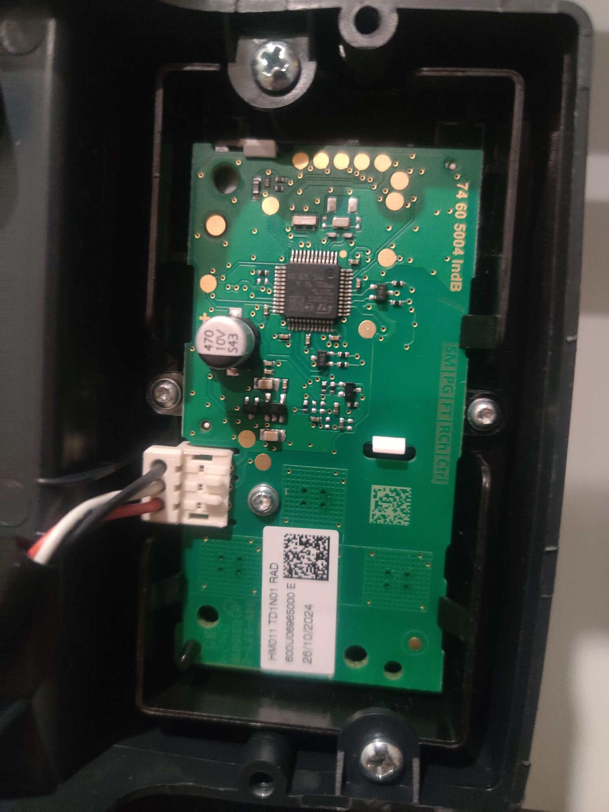

# sauter-marapi-esphome

**Français** · [English](README.en.md)

Pilotez votre sèche-serviettes Sauter Marapi depuis Home Assistant, en gardant son écran et ses touches : une petite carte Wi-Fi se glisse sur le bus interne du radiateur.



> [!NOTE]
> **État du projet.** Le protocole du bus interne est décodé, et les deux moitiés du montage sont validées avec un ESP sur table : il pilote la carte de puissance sur le radiateur, et il lit le boîtier de commande au banc. Le firmware Rust de la carte est écrit et compile, pas encore essayé sur le radiateur ; la carte définitive et son boîtier restent à faire.

## Ce que ça permet

- **Suivre le radiateur** : consigne, Boost et arrêt réglés sur les touches, chauffe en cours.
- **Le régler depuis Home Assistant** : consigne, Boost (soufflerie), arrêt.
- **Garder l'appareil d'origine** : l'écran et les touches continuent de marcher comme avant ; le dernier qui parle, touche ou Home Assistant, a raison.
- **Rien à brancher sur le 230 V** : la carte s'alimente sur le 5 V de la nappe, comme le boîtier de commande.
- **Sans risque** : sans Home Assistant, la carte se contente de transmettre, et le radiateur marche comme d'origine. Si la carte elle-même tombe en panne, le radiateur s'arrête (« Err 10 ») : il suffit de la débrancher et de reconnecter la nappe d'origine.

## Compatibilité

Étudié sur un **Sauter Marapi tactile 1750 W** (750 W de fluide et 1000 W de soufflerie), boîtier de commande `HM011 TD1N01 RAD`. Les sèche-serviettes et radiateurs du groupe Atlantic (Atlantic, Thermor, Sauter) qui affichent « Err 10 » quand leur nappe interne est débranchée utilisent probablement le même bus : à vérifier avec l'écoute de `discovery/`.

## Comment ça marche

Le radiateur a deux cartes, reliées par une nappe de trois fils (masse, 5 V, données) :

- le **boîtier de commande** (écran, touches tactiles) choisit la consigne, le mode et le Boost ;
- la **carte de puissance** chauffe le fluide et fait tourner la soufflerie, d'après sa propre sonde de température. Elle mène le dialogue : elle **appelle** le boîtier de commande plusieurs fois par seconde, et il répond par son état.

La carte coupe le fil de données et se place entre les deux, comme un intermédiaire (*man in the middle*). Par défaut, elle **relaie** chaque appel et chaque réponse, et Home Assistant voit ce qui se passe. Sur ordre de Home Assistant, elle **répond à la place** du boîtier de commande, jusqu'au prochain appui sur une touche.


**Limite** : le boîtier de commande n'accepte aucun ordre par le bus. Son écran affiche toujours ce qui a été réglé sur ses touches : un Boost lancé par Home Assistant ne s'y voit pas.

## Le bus interne en bref

Le détail, trame par trame, est dans [`knowledge/linap.md`](knowledge/linap.md).

- Un seul fil de données, **9 600 bauds, 7 bits et parité impaire**. Les trames font **5 octets** : un en-tête, 3 octets de données, puis leur XOR.
- La carte de puissance envoie `75`, `C7` et `61` en boucle (cycle de 305 ms). Après `75` et `C7`, elle envoie l'octet `46` seul : c'est l'appel. Le boîtier de commande répond **dans le bit qui suit**, par 3 octets et la somme de contrôle :

| Réponse à `46` | Sens |
|---|---|
| `B0 cc 80` | en marche, consigne = `cc` sans son bit 7, divisé par 2 |
| `38 80 80` | Boost |
| `80 80 80` | arrêt |

- La carte de puissance donne son état dans `C7` : `80 E0 38` au repos, `01 E0 38` en chauffe, `83 E0 98` en Boost, `80 E0 40` à l'arrêt.
- **La carte de puissance obéit à quiconque répond à temps** à ses appels. **Le boîtier de commande ne se laisse pas piloter** : il ne répond qu'aux appels `46` et `70`, et aucune des quelque 280 trames essayées n'a changé sa consigne ni son écran.

## La découverte du protocole

Aucune documentation n'existe sur ce bus. Il a été décodé avec un **Wemos D1 mini** branché sur la nappe, en trois étapes. Les firmwares, le schéma du banc et les outils sont dans [`discovery/`](discovery/README.md).

| Étape | L'ESP… | Résultat |
|---|---|---|
| 1. Écoute | écoute la nappe entre les deux cartes | format des trames, consigne, Boost, arrêt |
| 2. Fausse carte de puissance | appelle le boîtier de commande seul, sur table, sans secteur | il répond et donne tout ce qu'on fait sur ses touches, mais n'accepte aucun ordre |
| 3. Fausse carte de commande | répond à la carte de puissance, sur le radiateur | elle suit la consigne, le Boost et l'arrêt |

> [!WARNING]
> **Le bus interne est au potentiel du secteur.** Pendant les essais sur le radiateur, l'ESP flotte à ce potentiel : alimentation de laboratoire à sortie flottante, pilotage en Wi-Fi uniquement, jamais d'USB ni d'appareil relié à la terre. Couper le disjoncteur avant de toucher au montage. En cas de doute, faites appel à un électricien.

## Le matériel

> [!NOTE]
> En cours de conception : la carte reste à dessiner, avec deux voies et une réception assez rapide pour répondre dans le bit qui suit l'appel ([backlog](knowledge/backlog.md)).

Ce qui ne changera pas :

- **Un ESP32-C3 à antenne externe**, firmware en Rust : deux UART complètes, une par voie, et une réponse aux appels sur interruption. La place ne manque pas dans le radiateur, et une bonne antenne compte, loin de la box.
- **Alimentée par la nappe** : le 5 V de la carte de puissance tient ≈ 160 mA en tout, et un D1 mini avec le boîtier de commande en prend ≈ 120 (VCC à 5,11 V, démarrages du radiateur et Boost validés) ; le C3 reste à mesurer. Plus de 230 V à raccorder. Un condensateur de 470 à 1000 µF près de l'ESP absorbe les pointes du Wi-Fi.
- **Sur chaque voie**, le montage du banc : un pont diviseur pour lire DATA, un transistor NPN pour la tirer à la masse.
- **Toute la carte est au potentiel du secteur**, comme le boîtier de commande : elle doit être entièrement enfermée, sans rien de touchable, et se mettre à jour par Wi-Fi seulement.

## Firmware

Le firmware de la carte est en **Rust** pour l'ESP32-C3, dans [`firmware/`](firmware/README.md) : logique des trames testée sur ordinateur (`linap/`), réponse aux appels sur interruption et liaison MQTT avec Home Assistant (`mitm/`).

```sh
cp firmware/secrets.example.env firmware/secrets.env   # Wi-Fi et compte MQTT
(cd firmware/linap && cargo test)
(cd firmware/mitm && cargo run --release)             # flash en USB, avant tout câblage
```

Les firmwares du banc, eux, sont des configurations ESPHome pour D1 mini, dans `discovery/` :

```sh
uv tool install esphome
cp discovery/esphome/secrets.example.yaml discovery/esphome/secrets.yaml   # Wi-Fi, clé API, mot de passe OTA
esphome run discovery/1-sniffer/linap-sniffer.yaml       # premier flash en USB, avant tout câblage
esphome logs discovery/1-sniffer/linap-sniffer.yaml | discovery/tools/decode.py
```

## Dans Home Assistant

Par découverte MQTT (détail : [`firmware/README.md`](firmware/README.md)) :

| Entité | Usage |
|---|---|
| Keys mode, Keys setpoint | ce qui est réglé sur les touches |
| Power board, Heating | ce que fait la carte de puissance : attente, chauffe, Boost, arrêt |
| Control | `relay` (les touches, par défaut), `setpoint`, `boost`, `off` (imposés) |
| Setpoint | la consigne en vigueur ; la régler depuis Home Assistant l'impose |

Le dernier ordre gagne : un ordre de Home Assistant remplace celui des touches, et le prochain changement fait aux touches reprend la main.

Le boîtier de commande n'envoie que sa consigne effective : en Éco, Home Assistant voit la consigne Éco, sans savoir que c'est l'Éco.

## Limites connues

- **Écran non synchronisé** : ce que Home Assistant impose n'apparaît pas à l'écran.
- **Pas de température** pour l'instant : la carte de puissance a sa sonde, mais on ne sait pas encore dans quelle trame passe la mesure.
- **Garantie** : ouvrir le boîtier de commande fait perdre la garantie (2 ans).

## Pour aller plus loin

- [`knowledge/linap.md`](knowledge/linap.md) : le bus interne, trame par trame.
- [`knowledge/architecture.md`](knowledge/architecture.md) : rôle de la carte, solution retenue, pistes écartées, sécurité.
- [`knowledge/backlog.md`](knowledge/backlog.md) : ce qui reste à faire.
- `knowledge/manuals/` : notice Sauter.

---

**Mots-clés** : Sauter Marapi tactile, sèche-serviettes soufflant, radiateur électrique, Groupe Atlantic, Thermor, Atlantic, bus interne, liaison Linap, Err 10, man in the middle, rétro-ingénierie, Rust, esp-hal, embassy, ESP32-C3, ESPHome, Home Assistant, domotique, ESP8266, Wemos D1 mini, boîtier de commande `HM011 TD1N01 RAD`, `74 60 5004`, STM32F091CCT6, circuit imprimé KiCad.
