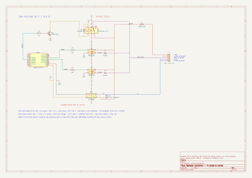
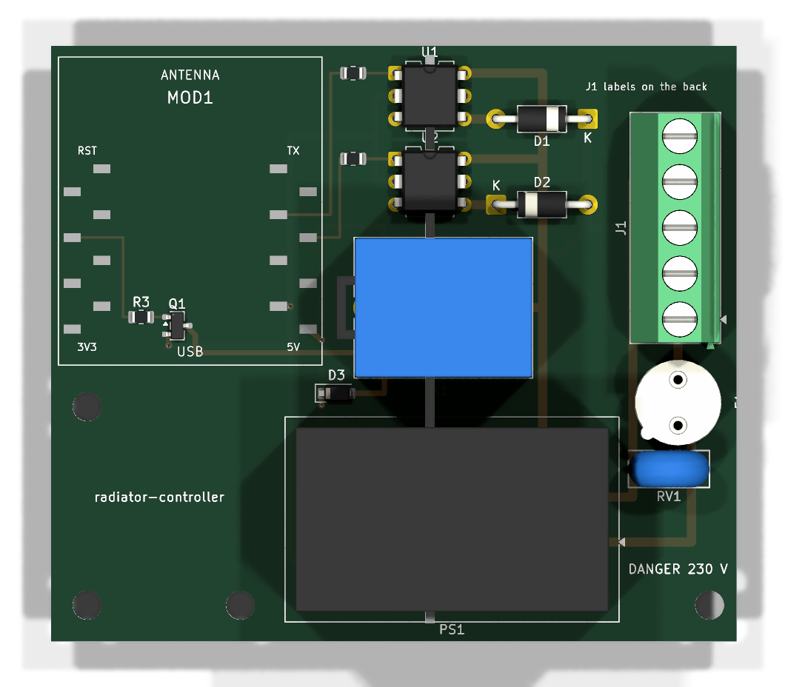
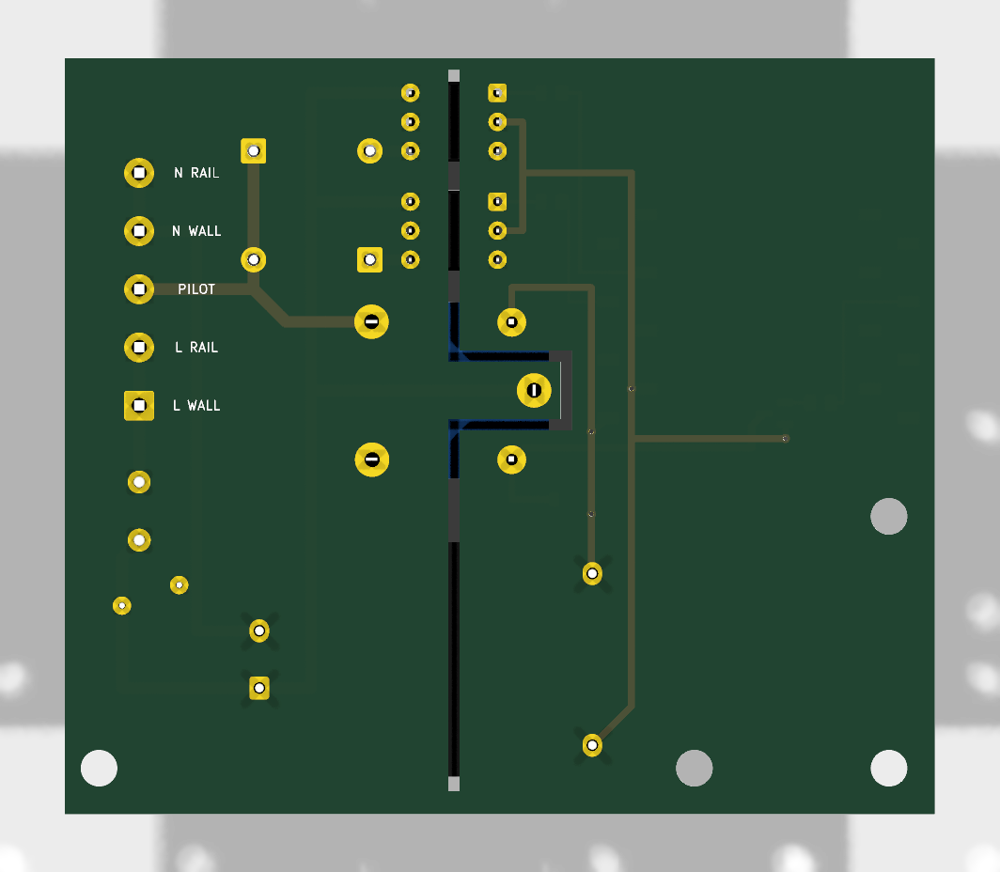

# radiator-controller

**Français** · [English](README.en.md)

Module DIY qui pilote le sèche-serviettes **Sauter Marapi tactile 1750 W** (anthracite) depuis Home Assistant, par son **fil pilote 6 ordres** (Confort, Confort −1, Confort −2, Éco, Hors-gel, Arrêt).

Firmware ESPHome sur un Wemos D1 mini (ESP8266), deux optotriacs MOC3043 + diodes, un relais de repli en Éco, alimenté en 230 V par l'arrivée murale du sèche-serviettes.

> [!WARNING]
> **Projet en phase d'étude.** Le module complémentaire (schéma, circuit imprimé, firmware) n'a encore été ni fabriqué ni testé : ses informations sont **théoriques**. Seules les données du fabricant (notice, signaux du fil pilote) et les photos de la carte d'origine sont des faits ; les pistes de rétro-ingénierie (touche Boost, liaison interne) sont des hypothèses. À vérifier avant toute réalisation.

**Mots-clés** : Sauter Marapi tactile, sèche-serviettes soufflant, radiateur fil pilote, Groupe Atlantic, ESPHome, Home Assistant, domotique, ESP8266, MOC3043, carte `HM011 TD1N01 RAD`, `74 60 5004`, STM32F091CCT6, touche Boost, liaison Linap, Err 10.

## Arborescence

| Dossier | Contenu |
|---|---|
| `firmware/` | configuration ESPHome : `common.yaml` (Wi-Fi, API, OTA, LED, diagnostic), `controlleur-seche-serviettes.yaml` (fil pilote), `secrets.example.yaml` |
| `hardware/` | KiCad 10 : schéma (`.kicad_sch`, rendu `.svg`), circuit imprimé (`.kicad_pcb`, rendus `-top.png` / `-bottom.png`), modèle 3D `radiator-controller.step` pour le boîtier (Fusion 360), symbole et empreinte du D1 mini, règles d'isolement (`.kicad_dru`) |
| `enclosure/` | boîtier (à venir) |
| `knowledge/` | `architecture.md` (rôles, contrat, sécurité), `fil-pilote.md` (signaux, schéma, nomenclature), `backlog.md`, notice Sauter (`manuals/`) |

## ⚠️ 230 V

Le module travaille sur le secteur, dans une salle de bains. Lire la section *Sécurité* de `knowledge/fil-pilote.md` avant de câbler. Couper au tableau avant toute intervention.

## Matériel et câblage



Ouvrir `hardware/radiator-controller.kicad_pro` dans KiCad, ou en ligne sur [KiCanvas](https://kicanvas.org/?github=https://github.com/Plokkke/radiator-controller/blob/main/hardware/radiator-controller.kicad_sch). Détails (signaux, nomenclature, sécurité) dans `knowledge/fil-pilote.md`. En bref :

| D1 mini | Branché sur |
|---|---|
| `5V` / `GND` | sortie du HLK-PM01 |
| `D1` (GPIO5) | 220 Ω → MOC3043 U1 (alternance positive) |
| `D2` (GPIO4) | 220 Ω → MOC3043 U2 (alternance négative) |
| `D5` (GPIO14) | 1 kΩ → MMBT2222A → relais K1 (contact repos = Éco) |

Sur le sèche-serviettes, sélectionner le mode **Programme Inactif** pour qu'il obéisse au fil pilote.

## Circuit imprimé

76 × 66 mm, 2 couches. Basse tension à gauche, 230 V à droite, séparés par une fente de 1 mm ; HLK-PM01, MOC3043 et relais sont à cheval sur la fente.

| Dessus | Dessous |
|---|---|
|  |  |

- **Relais SRD** : son commun (230 V) est placé entre les deux broches de bobine (5 V), à 3,5 mm. Une fente en U l'entoure et ne s'ouvre que côté 230 V, ce qui porte la ligne de fuite au-delà de 6 mm.
- **Règles de contrôle** (`radiator-controller.kicad_dru`) : entre 230 V et basse tension, 3 mm dans l'air et 6 mm de ligne de fuite ; entre conducteurs 230 V, 2,5 mm. Le DRC (`kicad-cli pcb drc --schematic-parity`) passe sans erreur ; restent 18 avertissements de sérigraphie coupée par la fente, voulus.
- **D1 mini** enfiché sur des barrettes CMS, dans l'ordre physique : `RST`/`TX` en haut, `3V3`/`5V` en bas. Repères du bornier au dos de la carte.

## Firmware

```sh
uv tool install esphome
cp firmware/secrets.example.yaml firmware/secrets.yaml   # puis renseigner les valeurs
cd firmware
esphome run controlleur-seche-serviettes.yaml --device /dev/cu.usbserial-XXXX   # premier flash, hors secteur
esphome run controlleur-seche-serviettes.yaml --device controlleur-seche-serviettes.local   # ensuite, OTA
esphome logs controlleur-seche-serviettes.yaml --device controlleur-seche-serviettes.local
```

## Entité Home Assistant

`select.controlleur_seche_serviettes_pilot_wire_order` : `Comfort`, `Comfort -1`, `Comfort -2`, `Eco`, `Frost protection`, `Off`. En panne ou sans HA pendant 30 min : `Eco`.
