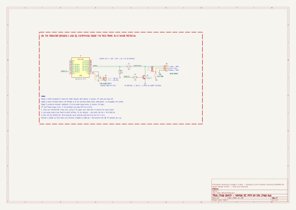

# Découverte du bus Linap

Comment le protocole du bus Linap a été trouvé, et les outils pour refaire chaque étape. Chaque étape garde son firmware ESPHome, même une fois dépassée ; le montage est un seul banc, dont le schéma évolue d'une révision à l'autre (voir *Évolution du montage*). Ce dossier est le cahier de laboratoire du projet.

| Étape | Dossier | Rôle de l'ESP | Où | État |
|---|---|---|---|---|
| 1 | [`1-sniffer/`](1-sniffer/) | écoute la nappe entre les deux cartes | radiateur | fait, protocole de base décodé |
| 2 | [`2-power-emulator/`](2-power-emulator/) | joue la carte de puissance face à la carte de commande seule | bureau, sans secteur | en cours |
| 3 | [`3-controller-emulator/`](3-controller-emulator/) | joue la carte de commande face à la carte de puissance seule | radiateur | à faire |

Les résultats (format des trames, consigne, Boost…) sont dans `knowledge/linap.md` ; ce fichier décrit la méthode.

## Le principe : un ESP flottant, piloté en Wi-Fi

**Le bus n'est pas isolé du secteur** : sa masse est reliée au neutre à travers l'alimentation de la carte de puissance. Tout ce qui se branche sur la nappe pendant que la carte de puissance est raccordée est donc au potentiel du secteur. Un analyseur logique relié au Mac est exclu (on l'a essayé hors secteur : ses captures longues échouaient de toute façon en USB).

D'où le banc :

- un **Wemos D1 mini** (ESP8266) relié à la nappe, qui **flotte** au potentiel du bus ;
- alimenté par une **alimentation de labo à sortie flottante** (sans borne de terre) quand la carte de puissance est branchée, par l'USB du Mac seulement sur le bureau, carte de commande seule et sans secteur ;
- piloté et lu **uniquement en Wi-Fi**, par le partage de connexion d'un téléphone posé à côté (ESP, Mac et téléphone au même endroit, signal fort) ;
- une **page web** sur l'ESP (`http://<nom>.local`) pour agir pendant l'essai, et un champ « Note » qui marque les observations dans les logs, au milieu des trames.

## Le banc

Schéma : [`linap-bench.kicad_sch`](linap-bench.kicad_sch), produit par [`generate-schematic.py`](generate-schematic.py).

| Repère | Composant | Rôle |
|---|---|---|
| U1 | Wemos D1 mini (ESP8266, 4 Mo) | écoute, émission, Wi-Fi |
| R1, R2 | 10 kΩ et 15 kΩ | pont diviseur : DATA 5,2 V → 3,1 V sur D2 |
| Q1, R6 | NPN (BC547, 2N2222, 2N3904…) et 10 kΩ de base | émission : D8 à l'état haut → DATA à l'état bas (étapes 2 et 3) |
| R7 | 4,7 kΩ, non montée par défaut | rappel de DATA au fil rouge, si la carte de puissance seule ne le fait pas (étape 3) |
| JP1 | cavalier 2 broches | fermé, le 5 V du D1 mini alimente le fil rouge de la nappe : étape 2 seulement |
| J1 | alimentation de labo réglable à sortie flottante, 5,0 V limitée à 300 mA | étapes 1 et 3 |
| J2 | pinces ou fils Dupont sur la nappe 3 fils (blanc DATA, rouge VCC, noir GND) | raccordement |
| — | multimètre, téléphone avec partage de connexion | mesures, réseau |

Monté ici avec les résistances du tiroir : R1 = 2 × 10 kΩ en série et R2 = 3 × 10 kΩ en série (20 k / 30 k, même rapport 0,6). Le schéma donne les valeurs standard.

| Étape | Alimentation | JP1 | Q1 | R7 | Secteur |
|---|---|---|---|---|---|
| 1. écoute | J1 | ouvert | bloqué (firmware sans émission) | non montée | oui |
| 2. fausse carte de puissance | USB, J1 débranchée | **fermé** | émet | non montée | **non** |
| 3. fausse carte de commande | J1 | ouvert | émet | si DATA reste bas au repos | oui |

**Pourquoi un NPN et pas une diode** pour émettre : une diode vers une broche à 3,3 V écrêterait DATA vers 3,6 V au repos, soit 2,2 V sur D2, sous le seuil haut de l'ESP8266. Q1 bloqué laisse DATA à 5 V. D8 est tiré à la masse sur le D1 mini au démarrage : Q1 reste bloqué pendant le boot et avec le firmware d'écoute.

## Étape 0 : mesures au multimètre

Avant tout branchement, nappe débranchée puis rebranchée, disjoncteur coupé pour les résistances : identification des fils (noir GND, rouge VCC 5,22 V, blanc DATA au repos à l'état haut) et **résistance entre GND et le neutre** (850 Ω / 1117 Ω, diodes en test) : c'est elle qui a montré que le bus est au potentiel du secteur. Détail dans `knowledge/linap.md`.

## Étape 1 : écoute (`1-sniffer/`)

- Montage : J1 alimente, JP1 ouvert, J2 piqué sur la nappe entre les deux cartes, VCC non utilisé.
- Firmware : `linap-sniffer.yaml`. `remote_receiver` journalise chaque trame comme la suite des durées de DATA en µs (positif = bas, négatif = haut), une trame se terminant après 10 ms au repos. Le décodage se fait sur le Mac : [`decode.py`](decode.py) retrouve le débit, lit les octets comme une UART et vérifie la somme de contrôle.
- **Capture guidée** : la page web affiche l'action suivante (liste dans `linap-sniffer-steps.h`) ; « Go » écrit un repère dans les logs, puis un compte à rebours dit quand passer à la suite. Les repères tombent dans le même flux que les trames : plus besoin de chronométrer ses gestes.

Déroulé :

1. Flasher **en USB, avant tout câblage** : `esphome run discovery/1-sniffer/linap-sniffer.yaml`. Vérifier les logs en Wi-Fi, puis **débrancher l'USB pour de bon** (mises à jour en OTA).
2. Vérifier l'alimentation de labo : OL à l'ohmmètre entre sa borne − et les broches de sa prise secteur.
3. Disjoncteur coupé : piquages blanc et noir sur la nappe, alimentation de labo à 5,0 V. Plus rien ne se touche ensuite.
4. `esphome logs discovery/1-sniffer/linap-sniffer.yaml | tee capture.log | discovery/decode.py`, puis réenclencher le disjoncteur et suivre la page.
5. Après coup : `discovery/decode.py capture.log --changes --ignore 75` n'affiche que les trames qui changent, entre les repères.
6. Couper le disjoncteur **avant** de toucher au montage.

Résultat (07/11/2026) : 9 600 bauds 8N1, trames de 5 octets avec XOR, qui parle quand, consigne, Boost, arrêt.

## Étape 2 : fausse carte de puissance (`2-power-emulator/`)

Question : la carte de commande accepte-t-elle un maître qui n'est pas la vraie carte de puissance, et suit-elle un état qu'elle n'a pas demandé, comme un Boost annoncé par `C7 83 E0 98` ?

- **Sans secteur** : la carte de commande seule, débranchée du radiateur, prend son 5 V sur le D1 mini alimenté en USB (JP1 fermé, J1 débranchée).
- Firmware : `linap-power-emulator.yaml`. L'ESP envoie le cycle `75`, `C7`, `61` toutes les 95 ms et décode les réponses.
- Page `http://linap-power-emulator.local` : marche/arrêt de l'interrogation ; état `C7` envoyé à chaque cycle (normal, Boost, chauffe, arrêt) ; ack Boost envoyé une seule fois ; envoi d'une trame quelconque (4 octets, somme de contrôle ajoutée) ; dernière trame `46` décodée.
- Contrôle du câblage : toutes les 10 s, le log `bus` compte nos trames entendues en retour sur DATA (0 = Q1 ne tire pas DATA) et les trames de la carte de commande.

Déroulé : `esphome run discovery/2-power-emulator/linap-power-emulator.yaml` en USB (la première fois), puis `esphome logs …` en Wi-Fi ; vérifier les échos, puis les réponses `46` ; essayer l'ack Boost seul, puis le Boost à chaque cycle, en notant l'écran.

## Étape 3 : fausse carte de commande (`3-controller-emulator/`)

Question : la carte de puissance obéit-elle à une carte de commande qui n'est pas la vraie (consigne, demande de chauffe, Boost, arrêt), et que fait-elle si personne ne répond ?

- Sur le radiateur, **carte de commande débranchée** : l'ESP flotte au potentiel du secteur, alimentation de labo, JP1 ouvert, **jamais d'USB** (mêmes règles qu'à l'étape 1). R7 n'est montée que si le heartbeat lit DATA à l'état bas au repos.
- Firmware : `linap-controller-emulator.yaml`. L'ESP répond comme la vraie carte (capture guidée) : `46` après `75`, `C7` et `76`, `70` à la place de `46` après un `75` toutes les 30 s environ, rien après `61`, `73`, `67`.
- Page `http://linap-controller-emulator.local` : réponse marche/arrêt ; mode (normal, Boost, arrêt) ; consigne ; bit de demande de chauffe, réglable à part pour savoir qui décide de chauffer ; envoi d'une trame quelconque à la place de la prochaine réponse ; dernières trames `C7` et `73` décodées.

Essais prévus : consigne haute sans demande, puis demande avec consigne basse (qui décide de chauffer ?) ; Boost et arrêt ; réponse coupée (quelle erreur, et reprise ?) ; suivre `73` pendant une chauffe.

## Évolution du montage

| Révision | Date | Changement | Pour |
|---|---|---|---|
| 1 | 07/11/2026 | D1 mini, pont diviseur sur D2, alimentation de labo ; cavalier JP1 prévu pour alimenter une carte seule sur le bureau | étape 1 |
| 2 | 08/11/2026 | émission : NPN Q1 et sa résistance de base R6 sur D8, collecteur sur DATA ; rappel R7 (non montée) entre DATA et le fil rouge | étapes 2 et 3 |

Les anciennes révisions restent dans l'historique git : `git log -- discovery/linap-bench.kicad_sch`.

## Fichiers communs

| Fichier | Rôle |
|---|---|
| `linap-bench.yaml` | paquet ESPHome de toutes les étapes : D1 mini, page web, note, heartbeat |
| `linap-transmitter.yaml` | paquet des émulateurs : émission sur D8 (UART0 matérielle, inversée), écoute sur D2, compteur d'échos, envoi d'une trame |
| `linap-frames.h` | codage et décodage des trames, trames connues, comptage des échos |
| `decode.py` | décodage sur le Mac des captures de l'étape 1 |
| `generate-schematic.py` | génère le schéma du banc |
| `linap-bench.kicad_sym` | symbole du D1 mini dessiné comme la carte : broches à leur place physique, vue de dessus, USB en bas (produit par `generate-schematic.py`) |
| `../firmware/network.yaml`, `../firmware/hotspot-wifi.yaml` | Wi-Fi (partage de connexion d'abord), API, OTA ; secrets dans `../firmware/secrets.yaml` |

Schéma : modifier `generate-schematic.py` (révision, date, note), le relancer, puis `kicad-cli sch erc` et `kicad-cli sch export svg` sur `linap-bench.kicad_sch`, et ajouter une ligne à *Évolution du montage*.
