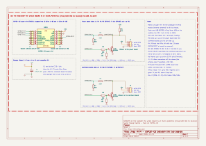

# Carte MITM

Un ESP32-C3 qui coupe le fil DATA de la nappe en deux : une voie vers la carte de puissance, une vers le boîtier de commande. VCC et GND traversent. Firmware : [`firmware/`](../firmware/README.md). Règles de dessin : [`CLAUDE.md`](../CLAUDE.md).



Révision 2 (11/11/2026) : le montage de la plaque d'essai, avec le C3 super mini ; ponts de lecture en 100 kΩ / 150 kΩ. Le circuit imprimé viendra une fois la plaque validée sur le radiateur.

## Les blocs

| Bloc | Pièces | Rôle |
|---|---|---|
| Module | MOD1 sur J3 et J4 | ESP32-C3 super mini enfiché ; le module définitif (antenne externe) reste à choisir |
| Alimentation | C1 | le 5 V de la nappe passe de J1 à J2 et alimente le C3 ; C1 absorbe les pointes du Wi-Fi |
| Voie carte de puissance | J1, R1, R2, R3, R4, R5, Q1 | lecture par le pont R1/R2 sur GPIO4, émission par Q1 depuis GPIO5, rappel de DATA par R5 |
| Voie boîtier de commande | J2, R6, R7, R8, R9, Q2 | lecture par le pont R6/R7 sur GPIO6, émission par Q2 depuis GPIO7 ; le boîtier fait son propre rappel |

- **Pont diviseur** : 5,2 V × 150 kΩ / 250 kΩ ≈ 3,1 V sur l'entrée du C3, au-dessus de son seuil haut (≈ 2,5 V). **Il doit charger DATA le moins possible** : le seul rappel de DATA est celui du boîtier de commande, et le boîtier ne reconnaît plus les appels quand DATA retombe vers 4,1 V au repos. Mesuré au bureau le 11/11/2026 : aucune réponse avec 10 k + 15 k (25 kΩ), une sur quatre et tronquée avec 20 k + 30 k (50 kΩ), toutes avec 100 k + 150 k (250 kΩ). Le rappel interne du C3 (≈ 45 kΩ) est coupé par le firmware, sinon l'entrée ne descendrait plus assez bas.
- **Émission** : GPIO à l'état haut → NPN passant → DATA à la masse. L'UART du firmware est donc inversée.
- **R4, R9** tiennent les NPN bloqués pendant le démarrage du C3. L'état de GPIO5 et GPIO7 pendant le reset reste à mesurer sur la plaque.

## Nomenclature

| Repère | Valeur | Boîtier | LCSC |
|---|---|---|---|
| MOD1 | ESP32-C3 super mini | module enfiché | — |
| J3, J4 | barrette femelle 1x8, pas de 2,54 | traversant | C27438 |
| J1, J2 | connecteur de nappe 3 points | à choisir (celui d'origine si possible) | à choisir |
| C1 | 470 µF 10 V | radial Ø 6,3 mm, pas de 2,5 mm | C43326 |
| R1, R6 | 100 kΩ 1 % 1/4 W | axial | C172965 |
| R2, R7 | 150 kΩ 1 % 1 W (pas de 1/4 W trouvée chez LCSC) | axial, 9 mm | C119513 |
| R3, R4, R8, R9 | 10 kΩ 1 % 1/4 W | axial | C57436 |
| R5 | 4,7 kΩ 5 % 1/4 W | axial | C1364279 |
| Q1, Q2 | 2N3904 | TO-92 (E-B-C, face plate vers soi) | C2874602 |

## Câbler la plaque d'essai

Sur le radiateur, **toute la carte est au potentiel du secteur** : disjoncteur coupé pour câbler, firmware flashé en USB avant tout câblage, jamais d'USB ensuite.

1. **Voie carte de puissance seule** (J1), boîtier de commande débranché : comme l'étape 3 de `discovery/`. Home Assistant passe « Control » sur `setpoint` puis `boost` ; « Polls answered » doit rester à 100 %. Mesurer ensuite la marge (« Reply gap ») et la consommation sur la nappe.
2. **MITM complet** : boîtier de commande sur J2. Vérifier que les touches sont relayées et qu'elles reprennent la main, puis allumer « Frame log » pour l'analyse.

## Régénérer

```sh
hardware/scripts/check.sh   # régénère le schéma, ERC sans violation, exporte linap-mitm.svg
```

Le schéma est produit par [`scripts/generate-schematic.py`](scripts/generate-schematic.py) : on le modifie là, pas dans KiCad. Le module partagé [`scripts/kicad_sheet.py`](scripts/kicad_sheet.py) sert aussi au schéma du banc (`discovery/bench/`).
