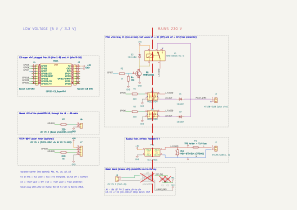

# Fil pilote : signaux et montage

Source : notice Sauter Marapi tactile (`manuals/sauter-marapi-tactile-notice-fr.pdf`, p. 8 et 20, réf. U0708012-D).

## Câble de l'appareil

| Fil | Rôle |
|---|---|
| Marron | phase |
| Bleu | neutre |
| Noir | fil pilote (signal mesuré **par rapport au neutre**) |

Appareil de classe II : **aucune terre**, et le fil noir ne doit jamais être relié à la terre.

## Ordres (fil pilote 6 ordres)

| Ordre | Signal fil pilote / neutre | Alternance positive | Alternance négative |
|---|---|---|---|
| Confort | 0 V (pas de signal) | – | – |
| Confort −1 °C | 230 V pendant 3 s, toutes les 300 s | impulsion | impulsion |
| Confort −2 °C | 230 V pendant 7 s, toutes les 300 s | impulsion | impulsion |
| Éco | 230 V | ✔ | ✔ |
| Hors-gel | demi-alternance négative (−115 V) | – | ✔ |
| Arrêt / délestage | demi-alternance positive (+115 V) | ✔ | – |

- **Confort −1 / −2** : consigne Confort moins 1 ou 2 °C, des paliers intermédiaires.
- **Arrêt** : plus aucune chauffe, même pas le hors-gel. **Délestage** : le même signal, envoyé par un délesteur qui coupe brièvement les radiateurs quand la maison approche de la puissance souscrite.
- **Éco** : consigne Confort moins l'abaissement « Abais. T ECO » (−3,5 °C par défaut, réglable de −1 à −9 °C, notice p. 15).
- **Le Boost (soufflerie 1000 W) n'a pas d'ordre fil pilote** : il ne s'active que par la touche de l'appareil. Voir `backlog.md`.

Délais de prise en compte (notice p. 20) : Confort → Éco ≈ 12 s ; Confort −1/−2 → Confort ≈ 5 min. Hors-gel et délestage sont prioritaires.

**Prérequis côté appareil** : mode **Programme Inactif**, sinon le sèche-serviettes suit son programme interne et ignore le fil pilote. En Confort, il suit la consigne réglée sur son écran.

## Schéma de la carte initiale

Ce document décrit la **carte initiale** (fil pilote et Boost, `hardware/pilot-wire/`). La carte finale, qui passe par le bus Linap, est décrite dans `linap.md`.

Source : `hardware/pilot-wire/radiator-controller-pilot-wire.kicad_sch` (KiCad 10), rendu ci-dessous ; version interactive sur [KiCanvas](https://kicanvas.org/?github=https://github.com/Plokkke/sauter-marapi-esphome/blob/main/hardware/pilot-wire/radiator-controller-pilot-wire.kicad_sch).

Un relais 5 V **à contact repos (NC)** relie la phase au fil pilote : au repos, il envoie 230 V, soit **Éco**. Quand l'ESP l'excite, le contact s'ouvre et deux optotriacs à détection de zéro prennent la main, chacun en série avec une diode qui ne laisse passer qu'une alternance. Le schéma est découpé en blocs encadrés (C3 et ses barrettes, fil pilote, Boost, compteur, alimentation, carte Boost) : câblés à l'intérieur d'un bloc, reliés entre blocs par des étiquettes. Couleurs des fils : rouge = phase, bleu = neutre, violet = fil pilote, orange = alimentations, vert = LED, bleu-vert = commande du relais, jaune = bobine du relais.

| Ordre | K1 (GPIO7) | U1 (GPIO5) | U2 (GPIO6) |
|---|---|---|---|
| Éco | repos | – | – |
| Confort | excité | – | – |
| Confort −1 / −2 | excité | impulsion | impulsion |
| Hors-gel | excité | – | ✔ |
| Arrêt | excité | ✔ | – |

- Carte hors tension, HLK-PM01 grillé, ESP planté (le chien de garde le redémarre, GPIO à 0) : K1 au repos → **Éco**. La bobine ne consomme (≈ 70 mA) qu'en dehors d'Éco, l'état le plus courant.
- GPIO5, GPIO6 et GPIO7 ne sont pas des broches de configuration au démarrage de l'ESP32-C3 (contrairement à GPIO2, GPIO8 et GPIO9), mais elles peuvent flotter ou porter un faible tirage pendant le boot. R4 (10 kΩ) tient la base de Q1 à la masse : K1 reste au repos, donc Éco, pendant le démarrage. Un tirage faible (≈ 50 µA) reste très loin du seuil des MOC3043 (5 mA).
- LED des MOC3043 : (3,3 − 1,3) / 220 ≈ 9 mA (seuil 5 mA max, 12 mA max par GPIO).
- L'entrée fil pilote consomme quelques mA : la sortie des MOC3043 (100 mA) suffit, sans triac de puissance.

## Nomenclature de la carte initiale

| Réf. | Composant | Boîtier | LCSC | Rôle |
|---|---|---|---|---|
| MOD1 | ESP32-C3 super mini, enfiché sur J3 et J4 | module | — | Wi-Fi, ESPHome |
| J3, J4 | barrette femelle CMS 1×8 hanxia HX PM2.54-1x8P TP H8.5-ZQ (pattes en quinconce, comme la carte chaudière) | CMS | C48641756 | support du C3 |
| PS1 | Hi-Link HLK-PM01 (230 V → 5 V, 3 W) | traversant | C209903 | alimentation isolée |
| F1 | support TR5 Littelfuse 56000001009 + fusible TR5 T1A 250 V temporisé Littelfuse 37211000001 | traversant | C142909 + C142808 | protection du module |
| RV1 | varistance Bourns MOV-07D431K (275 V AC, Ø 9 mm, épaisseur 4,8 mm) | traversant | C1528105 | surtensions, entre phase et neutre en entrée du HLK |
| U1, U2 | onsemi MOC3043M (optotriac, passage par zéro, IFT 5 mA max) | DIP-6 | C80489 | isolation et commutation du fil pilote |
| D1, D2 | onsemi 1N4007RLG | DO-41 | C53568 | sélection de l'alternance |
| R1, R2 | 220 Ω ¼ W, Yageo MFR-25FBF52-220R | axiale | C3537012 (en stock) | courant LED des optotriacs |
| K1 | relais Songle SRD-05VDC-SL-C (contact NC) | traversant | C35449 | repli Éco sans alimentation |
| Q1 | onsemi MMBT2222ALT1G | SOT-23 | C82460 | commande de la bobine de K1 |
| R3 | 1 kΩ ¼ W, Yageo MFR-25FBF52-1K | axiale | C1364484 (en stock) | base de Q1 |
| R4 | 10 kΩ ¼ W, Yageo MFR-25FBF52-10K | axiale | C1519255 | bloque Q1 pendant le démarrage |
| D3 | 1N4148W | SOD-123 | C81598 | roue libre de la bobine |
| J1, J2 | bornier à vis Kefa KF128-5.08-2P-AA (250 V, 24 A, jusqu'à 2,5 mm²) | traversant | C474952 | J1 : phase et neutre ; J2 : fil pilote. Le repiquage vers le sèche-serviettes se fait hors de la carte |
| J6, R7 | embase JST B2B-PH-K-S ; 220 Ω (en stock) | traversant | C131337 | commande de la LED du photoMOS du Boost (GPIO10) |
| J8 | embase JST B2B-PH-K-S, sur la carte Boost | traversant | C131337 | arrivée du câble JST PH 2 venant de J6, broche à broche |
| U3 | photoMOS 1 contact travail, DIP-4, **non monté** (choisi au banc) | traversant | — | simule le doigt sur la touche Boost |
| C1, C2 | condensateurs C0G 10 à 100 pF, en parallèle, **non montés** (réglés au banc) | 1206 | — | capacité ajoutée à l'électrode |
| TP1, TP2 | pastilles à souder Ø 2 mm, perçage 1 mm | traversant | — | fils courts vers le ressort Boost (TP1) et la masse de la carte de commande (TP2) |
| — | câble JST PH 2 broches, femelle des deux côtés, à la longueur voulue | — | — | J6 ↔ J8 |
| J7, R10 | embase JST B4B-PH-K-S ; 1 kΩ (en stock) | traversant | C131334 | compteur PZEM-004T v3 (5V, RX, TX, GND) ; R10 limite le courant de son TX 5 V vers GPIO20 |
| — | boîtier étanche IP44 minimum, presse-étoupes | — | — | salle de bains |

Panier LCSC : `hardware/pilot-wire/fabrication/radiator-controller-pilot-wire-lcsc-cart.csv`, produit par `hardware/export-fabrication.sh pilot-wire` à partir du champ `LCSC` du schéma (voir le README, *Commander*). Stocks relevés le 27/10/2026. Les empreintes suivent ces références : une autre pièce peut ne pas s'y monter.

Tout ce qui touche au 230 V reste en traversant, pour garder de grands écartements entre pastilles.

## Boost et compteur

La carte porte ce qu'il faut pour déclencher le Boost et brancher un compteur : il ne reste qu'à souder des pièces ou à brancher un câble.

### Boost (touche tactile)

Les touches sont capacitives : le microcontrôleur du boîtier de commande (STM32F091, contrôleur tactile TSC) mesure en permanence la capacité de chaque électrode (ressort doré → vitre). Un doigt ajoute quelques pF vers la masse ; c'est cette hausse qui fait une « touche ».

- **Principe** : un photoMOS (interrupteur MOSFET commandé par une LED, isolé) relie, à travers un petit condensateur, l'électrode Boost à la masse de la carte de commande. Fermé, il ajoute la capacité du condensateur : le TSC voit une touche. On le ferme ~300 ms, comme un appui.
- **La touche reste utilisable à la main** : le montage ne coupe rien, il ajoute une capacité en parallèle du doigt. Ouvert, il laisse une petite capacité résiduelle que le TSC absorbe en recalibrant sa ligne de base au démarrage ; la sensibilité au doigt baisse un peu, à vérifier au banc.
- **Le photoMOS doit être au plus près de l'électrode**, dans le boîtier de commande. Un fil de plusieurs dizaines de cm entre l'électrode et le photoMOS ajouterait en permanence sa propre capacité (et du bruit) à la touche, et risquerait de la rendre inutilisable. Ce qui voyage dans le câble, c'est seulement la commande de la LED du photoMOS, en basse tension : **J6** (GPIO10, 220 Ω, ≈ 9 mA) → câble JST PH 2 → **J8**.
- **Carte Boost détachable** (30 × 13 mm) : elle est dessinée sous la carte initiale, reliée par deux ponts de 3 mm à perforations (trous Ø 0,5 mm au pas de 0,8 mm, `Breakaway_MouseBites_3mm`). On la casse à la main, on la loge contre la touche Boost et on la relie par deux fils de quelques mm : **TP1** au ressort, **TP2** à la masse de la carte de commande.
  - montage : J8 → LED de **U3** (broches 1-2) ; sortie de U3 (broches 3-4) : TP2 (`LINAP_GND`) d'un côté, **C1 // C2** puis TP1 (`KEY`) de l'autre. Le condensateur est côté électrode : ouvert, U3 se retrouve en série avec lui, ce qui réduit encore la capacité ajoutée en permanence à la touche ;
  - isolement : `KEY`, `KEY_SW` et `LINAP_GND` sont dans la classe `Linap` (électronique du radiateur, au potentiel du secteur), donc à 3 mm dans l'air et 6 mm de ligne de fuite de J8. Les pastilles longues de U3 ne laissent que 5,2 mm : une fente de 1 mm sous U3 porte la ligne de fuite au-delà de 6 mm (vérifié par le DRC, qui signale l'écart sans la fente) ;
  - U3 en **DIP-4 traversant** (pastilles longues) : c'est le boîtier courant des photoMOS isolés à 3,75 kV ou plus. **C1 et C2** en 1206 : deux valeurs combinables au banc sans refaire la carte.
- **Le choix du photoMOS se fait au banc** : il faut une faible capacité à l'état ouvert (le AQY212EH proposé au départ monte à plusieurs dizaines de pF, ce qui noierait le doigt) et une isolation d'au moins 3,75 kV (la masse de la carte de commande est au potentiel du secteur). Le condensateur se règle aussi au banc (10 à 100 pF, C0G). Ni l'un ni l'autre n'est donc dans le panier (marqués non montés) ; la carte, elle, ne change pas.

Prérequis communs : mesurer, au multimètre et en isolé, le potentiel de la masse de la carte de commande par rapport au neutre ; garantie (2 ans) perdue dès qu'on ouvre le boîtier de commande.

### Compteur PZEM-004T (facultatif)

**J7** donne au PZEM-004T v3 son 5 V et une UART (GPIO21 → RX du PZEM, TX du PZEM → R10 → GPIO20). Sert aussi de retour d'état : ≈ 1750 W = Boost, ≈ 750 W = fluide seul, 0 = en attente.

## Sécurité

- **Tout le côté 230 V est sous tension dès que le disjoncteur est enclenché**, y compris le fil pilote. Couper au tableau avant toute intervention.
- Respecter l'isolement entre 230 V et basse tension sur la carte : ≥ 6 mm de ligne de fuite (fente sous les optotriacs, fente en U autour du commun de K1), vérifié par le DRC.
- Le module est **flashé en USB avant d'être monté**, puis mis à jour uniquement par OTA. Jamais d'USB branché quand il est raccordé au secteur : sur la plupart des C3 super mini, la broche `5V` est reliée directement au VBUS de l'USB-C.
- Le fil pilote et le radiateur sont protégés par le **même différentiel 30 mA** (exigence notice p. 8) : c'est le cas en repiquant l'arrivée murale du sèche-serviettes.
- Ne jamais couper l'alimentation du radiateur pour le piloter : la notice l'interdit (usure des cartes), le fil pilote est fait pour ça.
