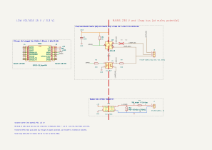

# Bus Linap et carte finale

La **carte finale** (`hardware/linap/`) pilote le sèche-serviettes par sa liaison interne, le bus Linap, entre le boîtier de commande et la carte de puissance (cf. « Err 10 »). Une fois le protocole connu, elle remplace le fil pilote et l'appui simulé sur la touche Boost de la carte initiale (`fil-pilote.md`). Elle sert aussi d'outil d'analyse : elle capture les trames à travers son optocoupleur.

## Ce qu'on sait du bus

- 3 fils, mesurés le 07/11/2026 au multimètre : **noir = GND**, **rouge = VCC 5,22 V**, **blanc = DATA**. DATA est au repos à l'état haut, ≈ 0,3 V sous VCC (écart statique : on le retrouve sans aucun trafic, il ne prouve pas d'activité). Un bus **sur un seul fil de données**, probablement en semi-duplex.
- **Carte de commande seule** (07/11/2026 ; nappe débranchée de la carte de puissance, alimentée en 5 V par USB, VCC 5,11 V) : aucune trame sur DATA, ni au repos ni en appuyant sur Boost (captures de 20 kHz à 1 MHz, ≈ 7 s au total), et aucune erreur affichée. La carte de puissance mène donc probablement le dialogue, ce que la première écoute, cartes branchées, a confirmé (ci-dessous).
- **Le bus n'est pas isolé du secteur** (mesuré disjoncteur coupé) : entre GND et le neutre, 850 Ω / 1117 Ω selon le sens, 0,320 V / 0,718 V en test de diode ; entre GND et la phase, OL dans les deux sens. La masse est reliée au neutre à travers l'alimentation de la carte de puissance : **ces trois fils sont au potentiel du secteur**, aucun appareil relié à la terre ou à un PC ne doit s'y brancher directement.
- R8 (VCC 5,22 V) : 1,5 kΩ.
- **Première écoute** (07/11/2026, 90 s, D1 mini en Wi-Fi, carte de puissance branchée) :
  - **9 600 bauds, 8N1**, bus au repos à l'état haut ; 1 574 trames, toutes décodées sans erreur à ce format (`decode.py --baud 9600`).
  - **Trames de 5 octets** : en-tête, 3 octets de données, puis le XOR des 3 octets de données (valide sur 100 % des trames).
  - **Deux émetteurs**, reconnaissables à leur signal : A allonge les états bas de ~9 µs (trames `46`, rarement `70`), B est exact (trames `75`, `C7`, `61`, rarement `73`, `67`, `76`).
  - **Cycle fixe** de 5 trames, ≈ 3,5 par seconde : `75 → 46 → C7 → 46 → 61`. B ouvre chaque cycle et A ne fait que répondre : B serait la carte de puissance, A la carte de commande (muette quand elle est seule). À confirmer.
  - Un appui sur Boost change les données des trames `46` (`B0 A1 80` → `38 80 80`) puis celles de `C7` et `61`. L'octet 3 des trames `75` décroît régulièrement (0x40 → 0x13 en 90 s), avec un bit 7 qui bascule indépendamment : mesure ou compte à rebours, à identifier.
- **Capture guidée** (07/11/2026, 14 min, 12 070 trames dont 2 erronées, une action par repère) :
  - **Consigne** : trame `46` de la carte de commande, octet 2, **7 bits de poids faible = consigne × 2** : 14,5 → `1D`, 15 → `1E`, 15,5 → `1F`, 20,5 → `29`, Éco 10,0 → `14`. Elle n'est émise qu'une fois la saisie terminée (≈ 5 s après la dernière touche) : de 14,5 à 20,5 par paliers rapides, une seule transition `9D` → `29`. La carte de commande envoie la **consigne effective** : en Éco, la consigne Éco, sans indication de mode.
  - **Boost** : `46 B0 xx 80` → `46 38 80 80` (octet 1 `B0` → `38`, consigne effacée) ; la carte de puissance répond `C7 83 E0 98` (au lieu de `C7 80 E0 38`). Retour à l'identique à l'arrêt du Boost.
  - **Arrêt par la touche** : `46 80 80 80 80` (tous les octets de données à `80`, comme au démarrage avant initialisation) et `C7 80 E0 40` ; remise en marche : retour à `46 B0 9D 80`.
  - **Mise sous tension** : le bus démarre en ≈ 3 s (`46 80 80 80 80`, `C7 80 E0 40 20`), la carte de commande envoie sa consigne ≈ 10 s plus tard.
  - **Verrouillage des touches** : aucun effet sur le bus, il est local à la carte de commande.
  - Hypothèses à confirmer : bit 7 de l'octet 2 de `46` à 0 quand la consigne dépasse la température ambiante (15,5 et 20,5 : 0 ; 14,5, 15 et 10 : 1) ; `C7` octet 1 `01` = chauffe du fluide en cours (apparaît avec ces consignes) ; `75` octet 2 (7 bits) varie en continu, tourne sur toute la plage 0-127 pendant le Boost (compteur ou mesure de la soufflerie ?) ; `61`, `67`, `73` à identifier.
  - Aucun écho de la consigne côté carte de puissance : la carte de commande en est la seule source. Le bit « demande » (`46` octet 2, bit 7) change, et 8 ms plus tard la carte de puissance passe `C7` à `01` et envoie `67 1F 40` (la même trame qu'au Boost) : la régulation semble décidée par la carte de commande.
  - `73` (carte de puissance, ponctuelle, juste après un changement de `46`) : candidate pour une température. Ses 7 bits bas de l'octet 2 descendent lentement d'une capture à l'autre (59, puis 56, puis 55) ; le bit 7 vaut 1 pendant la chauffe (`B9`, `BA`). Unité inconnue, à confirmer par la capture longue.
- Pas encore connus : le sens des trames `61`, `67`, `73`, `75`, et où passent la température ambiante et l'état de chauffe.

## Méthode

Les mesures, captures et essais, avec les firmwares et les schémas de chaque étape : [`discovery/`](../discovery/README.md).

## Schéma

Source : `hardware/linap/radiator-controller-linap.kicad_sch` (KiCad 10), rendu ci-dessous ; version interactive sur [KiCanvas](https://kicanvas.org/?github=https://github.com/Plokkke/sauter-marapi-esphome/blob/main/hardware/linap/radiator-controller-linap.kicad_sch).

Le montage ne dépend pas des inconnues du bus :

- **J5** se raccorde en dérivation sur les trois fils, dans le boîtier de commande, par un câble 3 conducteurs prévu pour le secteur. Sur la carte, ces fils sont traités comme du 230 V (classe `Linap` : 6 mm de ligne de fuite vers la basse tension ; entre eux, quelques volts seulement).
- **Lecture** : U3 (H11L1M) s'allume quand DATA est à l'état bas, sa LED alimentée par le fil VCC du radiateur à travers R8. Sa sortie à trigger de Schmitt fait que GPIO3 recopie DATA. Le bus ne voit que le courant de la LED (≈ 2,5 mA) pendant les états bas. **R8 se choisit après avoir mesuré VCC** : (VCC − 1,2 V) / 2,5 mA, soit 1,5 kΩ pour 5 V, 4,3 kΩ pour 12 V. Elle reste non montée jusque-là.
- **Écriture** : GPIO4 allume U4, dont le transistor tire DATA à la masse à travers R9 (100 Ω), comme n'importe quel nœud d'un bus à collecteur ouvert (UART inversée en émission). Tension supportée : 35 V.
- **Analyse des trames** : la sortie de U3 est déjà isolée. On lit GPIO3 (ESPHome `uart` avec `debug`, ou un analyseur logique branché sur la broche du C3, côté basse tension), sans analyseur sur le secteur.

Limites : si le bus s'avère piloté en push-pull et non en collecteur ouvert, l'écriture par U4 ne marchera pas telle quelle (la lecture, si). Au-delà de ~20 kbit/s, U4 (LTV-817, quelques µs de commutation) sera trop lent ; U3 tient 1 Mbit/s.

| C3 super mini | Branché sur |
|---|---|
| `5V` / `GND` | sortie du HLK-PM01 |
| `GPIO3` | sortie de U3, tirage R5 1 kΩ vers 3,3 V, découplage C1 |
| `GPIO4` | R6 220 Ω → LED de U4 (≈ 9 mA) |

GPIO3 et GPIO4 ne sont pas des broches de configuration au démarrage de l'ESP32-C3 : pas d'émission parasite sur le bus pendant le boot.

## Nomenclature de la carte finale

| Réf. | Composant | Boîtier | LCSC | Rôle |
|---|---|---|---|---|
| MOD1 | ESP32-C3 super mini, enfiché sur J3 et J4 | module | — | Wi-Fi, ESPHome |
| J3, J4 | barrette femelle CMS 1×8 hanxia HX PM2.54-1x8P TP H8.5-ZQ | CMS | C48641756 | support du C3 |
| PS1 | Hi-Link HLK-PM01 (230 V → 5 V, 3 W) | traversant | C209903 | alimentation isolée |
| F1 | support TR5 Littelfuse 56000001009 + fusible TR5 T1A 250 V temporisé Littelfuse 37211000001 | traversant | C142909 + C142808 | protection du module |
| RV1 | varistance Bourns MOV-07D431K (275 V AC) | traversant | C1528105 | surtensions, entre phase et neutre |
| J1 | bornier à vis Kefa KF128-5.08-2P-AA | traversant | C474952 | phase et neutre |
| J5 | bornier à vis Kefa KF128-5.08-3P-AA | traversant | C474953 | bus Linap : GND (broche 1, pastille carrée), VCC, DATA |
| U3 | onsemi H11L1M (sortie trigger de Schmitt, 1 Mbit/s, IFT 1,6 mA max, 4,17 kV) | DIP-6 | C16587 | réception isolée → GPIO3 |
| R5, C1 | 1 kΩ (C1364484, en stock) ; 100 nF X7R TDK FG28X7R1H104KNT06 | axiale ; pas de 5 mm | C342794 | tirage de la sortie de U3 ; découplage |
| R8 | résistance de la LED de U3, **non montée** : (VCC − 1,2 V) / 2,5 mA | axiale | — | réception |
| U4 | Lite-On LTV-817-C (phototransistor, 5 kV) | DIP-4 | C109225 | émission isolée (collecteur ouvert sur DATA) |
| R6 | 220 Ω (en stock) | axiale | C3537012 | LED de U4, depuis GPIO4 |
| R9 | 100 Ω ¼ W, Yageo MFR-25FBF52-100R | axiale | C6300650 | limite le courant tiré sur DATA |

Panier LCSC : `hardware/linap/fabrication/radiator-controller-linap-lcsc-cart.csv`, produit par `hardware/export-fabrication.sh linap` (voir le README, *Commander*). Stocks relevés le 27/10/2026.

## Sécurité

- **Le bus Linap est au potentiel du secteur** : couper au tableau avant de toucher au boîtier de commande ou à J5. Le câble entre J5 et le boîtier de commande est un câble prévu pour le secteur.
- Avant tout raccordement, mesurer en isolé le potentiel de la masse de la carte de commande par rapport au neutre. La garantie (2 ans) est perdue dès qu'on ouvre le boîtier de commande.
- Isolement sur la carte : ≥ 6 mm de ligne de fuite entre le côté secteur (230 V et bus Linap) et la basse tension, fente sous U3 et U4, vérifié par le DRC.
- Comme sur la carte initiale : C3 flashé en USB avant montage, jamais d'USB branché sur le secteur (la broche `5V` du C3 est reliée au VBUS).
